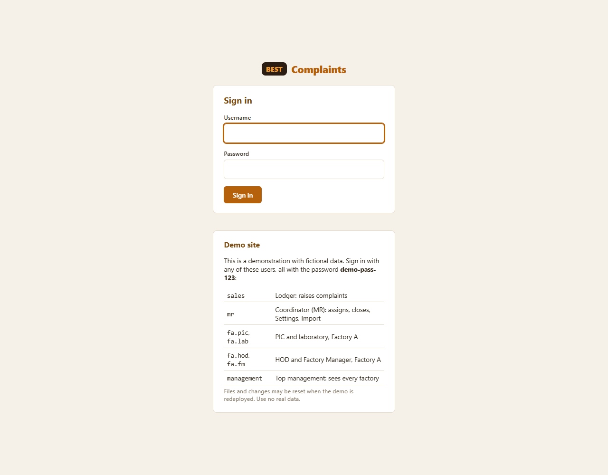

# Putting the demo on Render (free)

How to publish the platform as a **demo** on [Render](https://render.com), with a free web service and a free PostgreSQL database. Everything the host needs is already in the repository: `render.yaml` (the blueprint), `build.sh` (the build step) and the production settings in `config/settings.py`.

This is for a demonstration with fictional data. It is not set up for real complaints: see [section 6](#6-before-a-real-launch).

## 1. What the free plan means

These come from Render's free-tier terms at the time of writing. Check [render.com/docs/free](https://render.com/docs/free) before you rely on them, because they change.

| On the free plan | What it means for the demo |
|---|---|
| The web service goes to sleep after about 15 minutes with no visits | The first visit after a quiet spell takes up to a minute to load. Open the site a minute before showing it. |
| The free database [expires 30 days after it is created](https://render.com/changelog/free-postgresql-instances-now-expire-after-30-days-previously-90); it is 1 GB and has no backups | After 30 days make a new free database and redeploy (section 5). The demo data is created again. |
| The web service's disk is not kept | Files uploaded in the demo disappear when the service restarts or redeploys. The pages cope with a missing file: the download is not found and the audit pack lists it. |
| No scheduled jobs on the free plan | Reminders are sent with the **Send due reminders now** button on the Notifications page (Coordinator only). |
| Email | With no mail server set, emails are not sent: Django prints them in the service log. The Notifications page still lists every one as *Sent*, with its text, so the demo can show them, but nothing leaves the service. Outbound mail may also be limited on free instances. |

## 2. Deploy it

1. **Push the repository to GitHub.** The blueprint is read from the repository, so push the latest commit: `git push`. (The remote is `https://github.com/ylpang-8343/Customer-Complaint-Platform`.)
2. In Render, sign in with GitHub, then choose **New > Blueprint** and pick the repository.
3. Render reads `render.yaml` and shows the two things it will create: the web service `customer-complaint-platform` and the database `complaints-db`, both on the free plan. Choose **Apply**.
4. Wait for the first deploy (a few minutes). Render runs `build.sh`, which installs the packages, gathers the static files, updates the database and loads the demo users and twelve demo complaints. The service is live when the log says the service is live and the health check `/healthz/` passes.
5. Open the address Render shows (like `https://customer-complaint-platform.onrender.com`). The sign-in page lists the demo users and their password. Try `mr` (the Coordinator) first.

### What the blueprint sets

| Variable | Value | Why |
|---|---|---|
| `DJANGO_DEBUG` | `false` | Production mode: HTTPS only, secure cookies, hashed static files |
| `DJANGO_SECRET_KEY` | generated by Render | Signs sessions and forms |
| `DATABASE_URL` | the database's connection string | Where the data lives |
| `PYTHON_VERSION` | `3.12.7` | The version the project was built and tested on |
| `DEMO_MODE` | `true` | Lists the demo users on the sign-in page |
| `DEMO_DATA` | `1` | `build.sh` loads the demo users and complaints (only if the database has no complaints) |

Render also tells the app its own address (`RENDER_EXTERNAL_HOSTNAME`, `RENDER_EXTERNAL_URL`), which the settings use for the allowed host, the trusted origin for forms, and the links in emails. Nothing else needs setting.

**An administrator** (to open the audit log or create users, which the Coordinator cannot) can be created without a shell. In the service's **Environment** tab add `DJANGO_SUPERUSER_USERNAME`, `DJANGO_SUPERUSER_EMAIL` and `DJANGO_SUPERUSER_PASSWORD`, then redeploy. Then sign in at `/admin/`.

## 3. Check it after deploying

A quick walk-through (about five minutes), signing in with the demo password:

1. `/healthz/` shows `ok`, and `http://` addresses redirect to `https://`.
2. Sign in as `mr`: **My complaints** lists 12 complaints, and the **Dashboard** counts 12 with charts.
3. **Notifications** lists the demo emails and says some reminders are due. Choose **Send due reminders now**: the message says they were sent and none are due afterwards.
4. Open a complaint and choose **PDF report** and **Audit pack**; on **Complaint log** choose **Export to Excel**.
5. Open a *Submitted* complaint and choose **Assign PICs**, tick a PIC and assign it.
6. Sign in as `fb.pic`: only Factory B's complaints are listed.

The [Test Guide](TestGuide.md) has the full manual script.

## 4. How it was checked

This was prepared without a Render account, so it has not run on Render itself. It was checked on a local copy that behaves the same way:

- The whole automated suite (`pytest`) passes on **PostgreSQL 16**, not only on the SQLite used in development.
- `build.sh` was run against an empty PostgreSQL database with the production settings, twice (a redeploy keeps the demo data as it is).
- The app was then run in production mode behind a stand-in for Render's HTTPS proxy and driven in Chrome: HTTP redirected to HTTPS, the health check answered on plain HTTP, the stylesheet came with a hashed name, sessions and CSRF cookies were `Secure`, sign-in worked, the dashboard, notifications, reminders button, PDF report, audit pack, Excel export, a workflow step, and an upload and download all worked.

So the first real deploy is the first time it runs on Render's own network. If something fails there, section 7 lists the likely causes.

## 5. Looking after it

- **Updates.** Pushing to the connected branch deploys again. Use **Manual Deploy** in Render to redeploy without a push.
- **Reset the demo data.** Complaints made during the demo stay until you reset them. To start again, delete the database in Render, create a new free one called `complaints-db`, and redeploy: `build.sh` loads the demo data again.
- **The database expires after 30 days.** Do the same. Free databases cannot be restored after they expire, so keep nothing there that you need.
- **Logs.** The service's **Logs** tab shows errors, sign-in problems and the output of `build.sh`.

## 6. Before a real launch

The demo settings are deliberately not what a real site should use:

- Remove `DEMO_MODE` and `DEMO_DATA`, and use a paid plan: a paid database with backups, and a service that does not sleep.
- Store uploaded files on a persistent disk or object storage, and back them up. On Render the free disk is erased on every restart.
- Run `send_reminders` once a day with a scheduler (a Render cron job, or the host's own).
- Send real email by setting `EMAIL_HOST`, `EMAIL_PORT`, `EMAIL_HOST_USER`, `EMAIL_HOST_PASSWORD`, `EMAIL_USE_TLS` and `DEFAULT_FROM_EMAIL`, and test that customers receive it.
- Once HTTPS works, set `DJANGO_HSTS_SECONDS` (for example `31536000`).
- Add a "forgot password" page and sign-in lockout, or single sign-on. Only an administrator can create users and reset passwords today.
- Change every demo password, or delete the demo users.

## 7. If something goes wrong

| What you see | Likely cause and fix |
|---|---|
| The build fails | Open the deploy log. A missing package means `requirements.txt` is out of date. A line ending error in `build.sh` means it was saved with Windows line endings (`.gitattributes` prevents that). |
| `Bad Request (400)` | The address is not an allowed host. Add it in `DJANGO_ALLOWED_HOSTS` (a custom domain), or deploy with the default Render address. |
| `Forbidden (403) CSRF verification failed` | The address people use is not trusted. Add it, with `https://`, in `DJANGO_CSRF_TRUSTED_ORIGINS` (needed for a custom domain). |
| The pages have no styling | The static files were not gathered: check that the build log shows `collectstatic` ran. |
| Very slow first page | The free service was asleep. It wakes within a minute. |
| Database errors after about a month | The free database expired (section 5). |
| Links in emails point to `127.0.0.1` | `SITE_URL` is not set. On Render it comes from `RENDER_EXTERNAL_URL`; for a custom domain set `SITE_URL`. |
| *Failed* emails in Notifications | A mail server is set and refused the message (see the reason shown). With no mail server set, the demo shows every email as *Sent* but sends none. |
