# Test Guide

How to test the Group Customer Complaint Platform: the automated tests, a manual test script for each step of the process, and how the screenshots in `docs/img/` are made. The process and the rules come from `FINAL_Customer_Complaint_Platform_Proposal.pdf`. Where the proposal was silent and an assumption was made, it is listed in section 8 of [Development_Ideas.md](Development_Ideas.md).

Everything here uses fictional demo data.

## 1. What is covered

| Proposal | Built and testable |
|---|---|
| Steps 1 and 2: lodge, save as draft, submit | Yes |
| Step 3: Coordinator assigns PICs | Yes |
| Step 4: PIC investigation, laboratory section | Yes |
| Step 4a: SCAR to an external party | Yes |
| Steps 5 and 6: HOD review, FM approval and the repeat cycle | Yes |
| Step 7: reply to the customer | Yes |
| Step 8: effectiveness check and closing | Yes |
| Reminders after 3 days (set per complaint type), notification log | Yes |
| Dashboard, complaint log, Excel export | Yes |
| Access by role and factory, change log, lists the Coordinator maintains | Yes |
| PDF export in the layout of the current report, upload of the past 6 months | Not built yet (build step 6) |
| Traders' view | Phase 2, out of scope |

The PDF summary that is mailed to PICs (and the SCAR PDF) are built; only the layout of the current Customer Complaint Report is still to come.

## 2. Before you start

```powershell
python -m venv .venv
.venv\Scripts\python -m pip install -r requirements.txt
.venv\Scripts\python manage.py migrate
.venv\Scripts\python manage.py seed --demo
.venv\Scripts\python manage.py runserver
```

Open <http://127.0.0.1:8000/>. Every demo user has the password `demo-pass-123`.

| Username | Role | Used for |
|---|---|---|
| `sales` | Lodger outside the factories | Lodging complaints |
| `mr` | Coordinator (MR) | Assigning, closing, deleting, Settings, notifications |
| `management` | Top management | Read-only view of every factory, dashboard, notifications |
| `fa.pic` | PIC, Factory A | Investigation, SCAR, reply to the customer |
| `fa.lab` | Laboratory PIC, Factory A | Laboratory section |
| `fa.labmgr` | Lab manager (a PIC), Factory A | A second PIC who is not always assigned |
| `fa.hod` | HOD, Factory A | HOD review |
| `fa.fm` | FM, Factory A | FM approval |
| `fb.pic`, `fb.hod`, `fb.fm` | The same roles in Factory B | Testing that factories are kept apart |

Factories B to E have the same pattern (`fc.pic`, `fd.hod` and so on).

- **Emails** are printed in the window that runs `runserver` (the console), so you can read each one. Nothing leaves the computer.
- **Start again** at any time: stop the server, delete `db.sqlite3` and the `media` folder, then run `migrate` and `seed --demo` again.
- Use **a separate browser window (or a private window) for each user**, or sign out between users. Two users in one window share one session.

## 3. Automated tests

```powershell
.venv\Scripts\python -m pytest              # all tests
.venv\Scripts\python -m pytest -x -q        # stop at the first failure, short output
.venv\Scripts\python -m pytest tests\test_workflow.py -k hod     # only some tests
```

They take about a minute and use a temporary database and a temporary folder for uploads, so they never touch `db.sqlite3` or `media/`. Emails go to an in-memory outbox, which the tests read.

**Expected result: 181 passed.** Anything else is a defect (or a change that needs its tests updated).

| File | Tests | What it checks |
|---|---|---|
| `tests/test_accounts.py` | 10 | Roles, factories, factory-scoped access, deputies, the Coordinator group |
| `tests/test_audit.py` | 6 | The change log records who changed what, and cannot be edited |
| `tests/test_views.py` | 5 | Sign-in, sign-out and who may open Settings |
| `tests/test_complaints.py` | 45 | Reference numbers per factory and year, the conditional fields, mandatory fields, drafts, attachments (type and size), private drafts, the email to the Coordinator |
| `tests/test_layout.py` | 9 | The menu, stat tiles, list filters and paging, the Help page |
| `tests/test_workflow.py` | 49 | Steps 3 to 8: who may do each step and when, the emails, the laboratory gate, the SCAR lock, HOD and FM decisions and the repeat cycle, the reply, closing, deleting, deputies, access between factories |
| `tests/test_progress.py` | 6 | The progress bar at the top of a complaint |
| `tests/test_reminders.py` | 23 | The notification log (including failures), when reminders are due and to whom, repeats, per-type days, deputies, retry after a failure, the Overdue flags |
| `tests/test_reports.py` | 28 | Dashboard figures and filters, scope by role, the log columns, the Excel file (columns, dates, summary, scope, formula-like text) |

## 4. Manual test script

Do the scenarios in order: later ones use the complaint from the earlier ones. Tick the box when the expected result is what you see. If it is not, note the scenario number, what you did and what you saw. The screenshots show what the expected result looks like.

All scenarios assume the demo data from section 2 and a complaint for **Factory A** (reference `FA/2026/0001`).

### A. Sign in and access

**T01 Sign in and out** (any user)
1. Open the site. You are taken to the sign-in page. Sign in with a wrong password for `fa.pic`.
2. Sign in with the right password, then choose **Sign out**.

Expected: the wrong password shows an error and stays on the sign-in page. The right one opens *My complaints*, with the menu on the left and your name, department and role in the *Signed in as* box. After signing out you cannot open any page without signing in again.

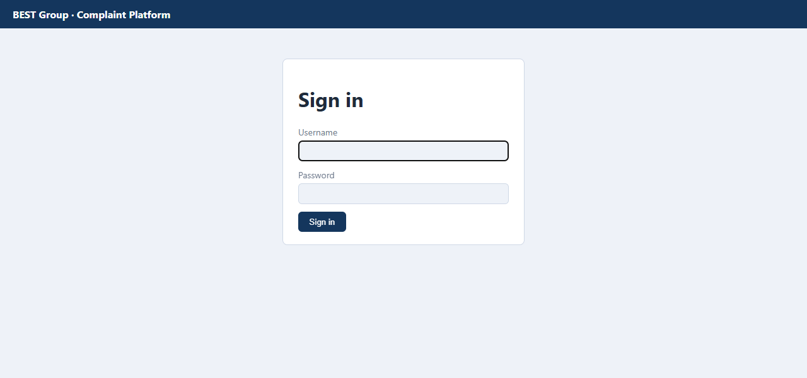 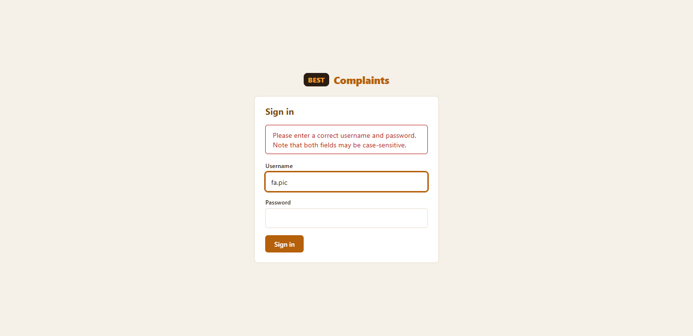

- [ ] Pass

**T02 Settings are for the Coordinator only** (`fa.pic`, then `mr`)
1. As `fa.pic`, open <http://127.0.0.1:8000/admin/>.
2. As `mr`, choose **Settings** in the menu.

Expected: `fa.pic` is refused and has no *Settings* link. `mr` can maintain complaint types and sub-types, lab tests, complaint methods and each factory's PIC list, and sees no other settings.

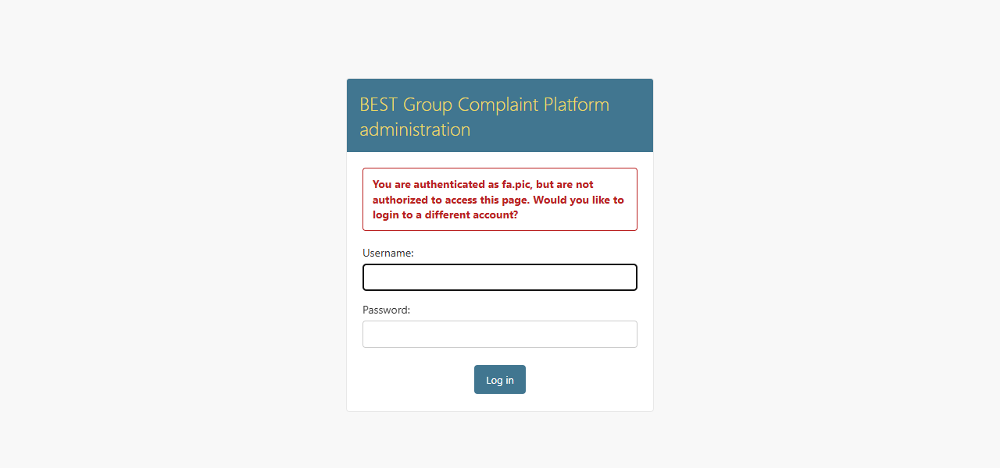 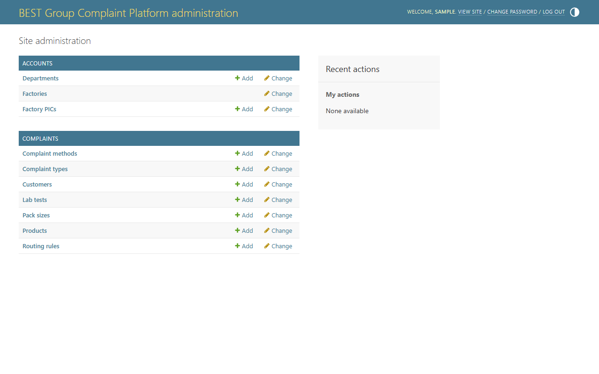

- [ ] Pass

### B. Lodging (steps 1 and 2)

**T03 Lodge a complaint and save a draft** (`sales`)
1. Choose **New complaint**. Choose *Factory A*, type a buyer name, and choose **Save draft**.

Expected: the message *Draft FA/2026/0001 saved*. The reference carries the factory code, the year and a running number for that factory. The lodger, department and date come from the profile and cannot be edited. The factory can no longer be changed. The draft is in *My complaints* with status *Draft*, and no one else can see it (check later as `mr`).

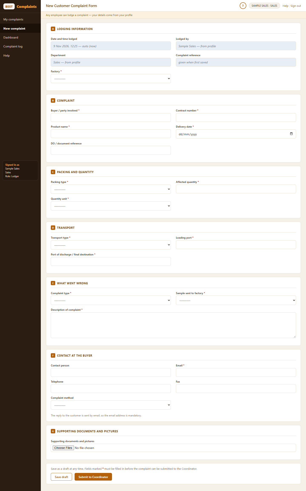 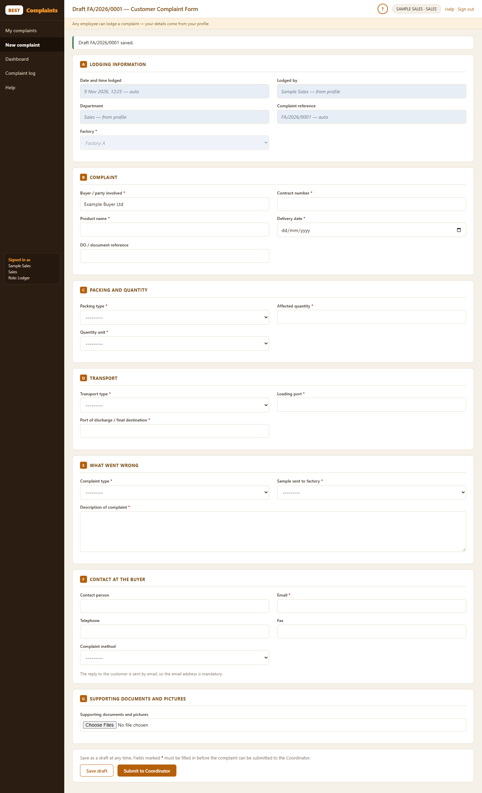

- [ ] Pass

**T04 Fields open depending on the choices** (`sales`, on the form)
1. *Packing type*: choose Pack, then Bulk.
2. *Transport type*: try each of the four choices.
3. *Complaint type*: choose Packaging, then Logistic, then Others. Choose a sub-type ending in *Others*.

Expected: *Pack size* opens only for Pack. Shipment - Bulk shows the vessel; Shipment - Container shows vessel and container; Local Delivery - Bulk shows the vehicle; Local Delivery - Container shows vehicle and container. The sub-type list holds only the sub-types of the chosen type, and changing the type clears a sub-type that no longer fits. *Others*, or a sub-type *Others*, opens *Short details*.

- [ ] Pass

**T05 Submitting is blocked until the mandatory fields are filled** (`sales`)
1. Open the draft and choose **Submit to Coordinator** with most fields empty.

Expected: you stay on the form, every missing field is marked in red, and a message says the draft is saved. The mandatory fields are the factory, buyer, contract number, product, delivery date, packing type, affected quantity and unit, transport type, loading port, port of discharge, complaint type, sample sent, description and the buyer's email address.

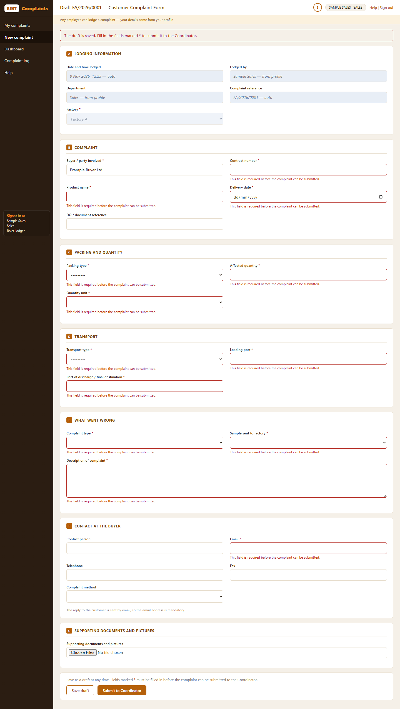

- [ ] Pass

**T06 Complete, attach and submit** (`sales`, then `mr`)
1. Fill in every mandatory field (set *Sample sent to factory* to **Yes**), attach a PDF or picture, and choose **Submit to Coordinator**.
2. Download the attached file from the complaint. Try to attach a `.exe`.
3. Try to open the edit page of the submitted complaint.

Expected: *Complaint FA/2026/0001 was submitted to the Coordinator*, status *Submitted*, and the Coordinator receives an email with a summary and a link (see the console). The file downloads under its own name; the `.exe` is refused. A submitted complaint cannot be edited. As `mr` the complaint is in the list; as `fb.pic` it is not.

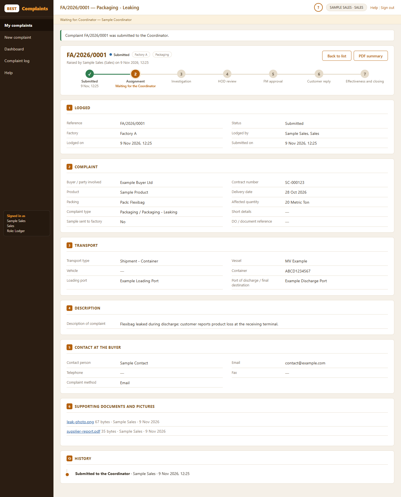

- [ ] Pass

### C. Assignment, investigation and the laboratory (steps 3 and 4)

**T07 The Coordinator assigns the PICs** (`mr`)
1. Open the complaint and choose **Assign PICs**. Tick only *Production PIC* and choose **Assign and send**.
2. Tick *Production PIC* and *Lab PIC* and choose **Assign and send** again. Add a remark.

Expected: the first attempt is refused because a sample was sent and no laboratory PIC is chosen. The second works: status *PIC investigation*, *Received by* shows the Coordinator, the acknowledgement date and time are filled, and each PIC gets an email with the reference, the remark, a link and a PDF summary attached. Only a PIC of Factory A can be chosen.

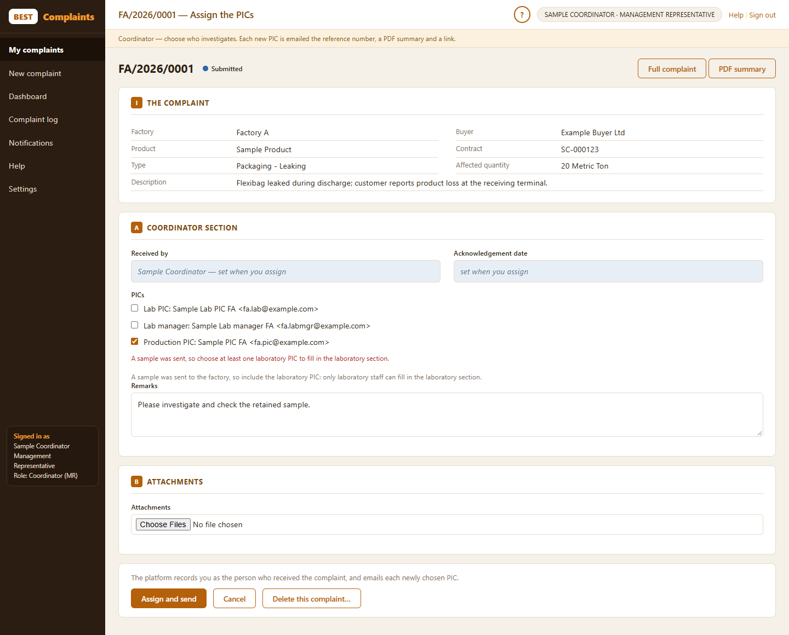 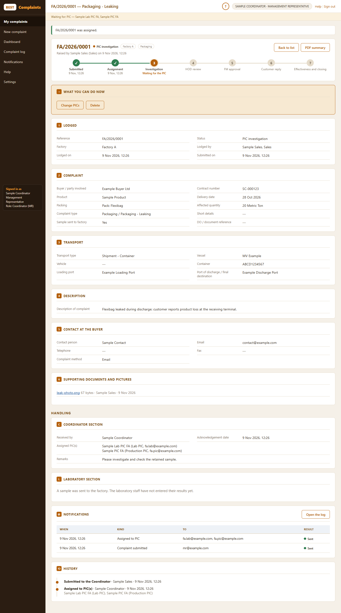

- [ ] Pass

**T08 The laboratory section** (`fa.lab`, then `fa.pic`)
1. As `fa.lab` choose **Laboratory section**. Enter the lab acknowledgement date, results for a few tests (from the buyer's sample and the retained sample), remarks and a report file, and save.
2. As `fa.pic`, open the same address.

Expected: *Tested by* is the signed-in lab user. The grid has the tests the Coordinator set (FFA, M&I, PV, IV, Colour, Appearance and odour). `fa.pic` cannot edit the section.

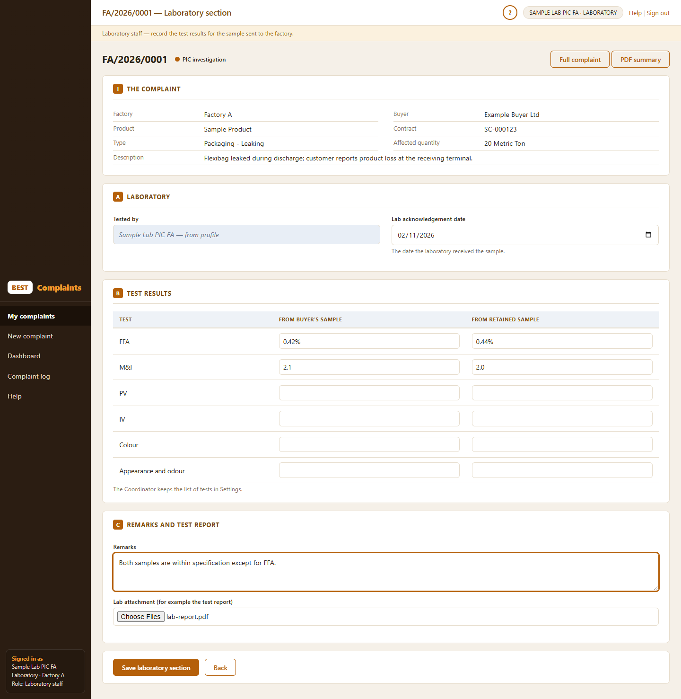

- [ ] Pass

**T09 The investigation** (`fa.pic`)
1. Choose **Investigation**, type only a root cause, and choose **Submit to HOD**.
2. Fill in the correction, the corrective and preventive action and the cause, and **Save**.

Expected: the first attempt lists what is missing and says the changes are saved. Another PIC of the factory who is not assigned (`fa.labmgr`) cannot open the investigation.

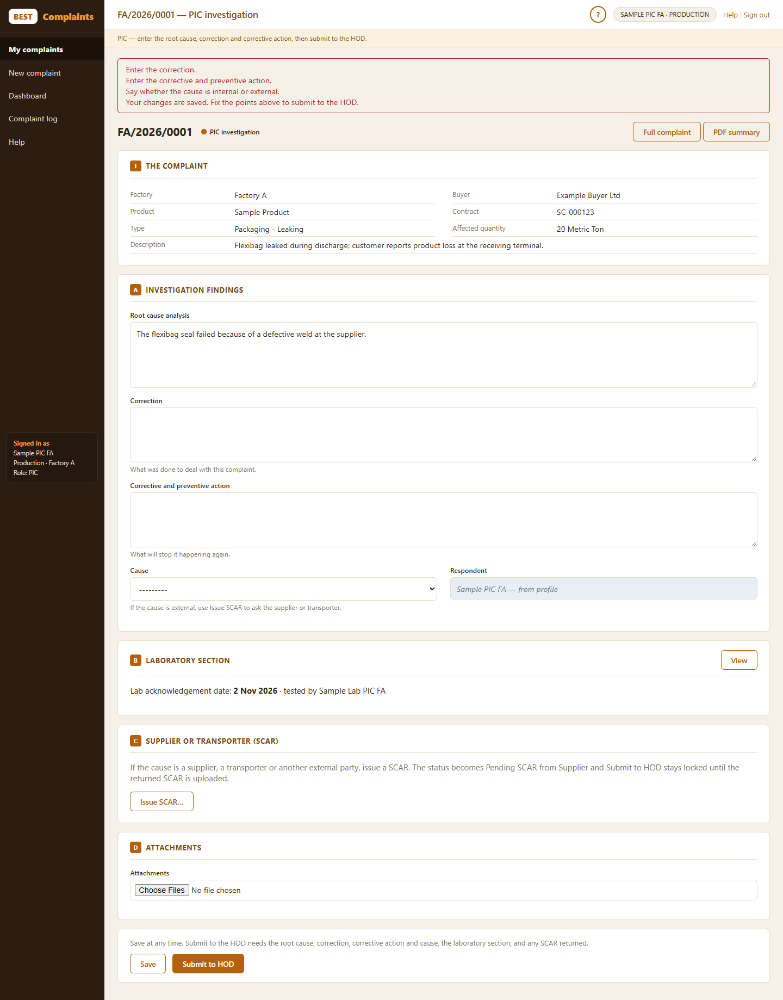

- [ ] Pass

**T10 SCAR to an external party** (`fa.pic`)
1. Choose the cause *External*, **Save**, then **Issue SCAR…**. Enter a party name and email and choose **Generate again**. Choose **Send SCAR**.
2. Open **Investigation** again and look at *Submit to HOD*.
3. Choose **Upload returned SCAR**, upload a file, then **Submit to HOD**.

Expected: the wording is filled from a template and *Generate again* rebuilds it for the party's name. The SCAR is emailed, with a PDF and the complaint reference, and the status is *Pending SCAR from Supplier*. *Submit to HOD* is locked until the returned SCAR is uploaded; then the status goes back to *PIC investigation* and the submission works, and the HOD is emailed. The buyer's name is not in the SCAR PDF.

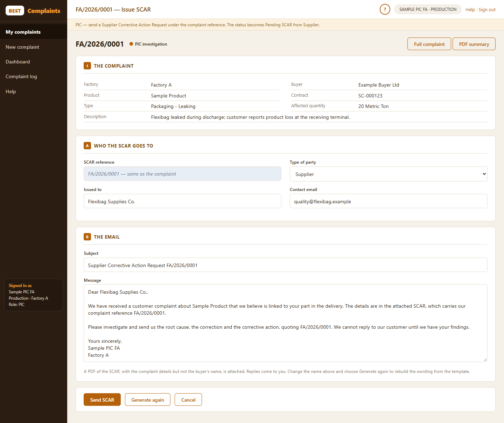 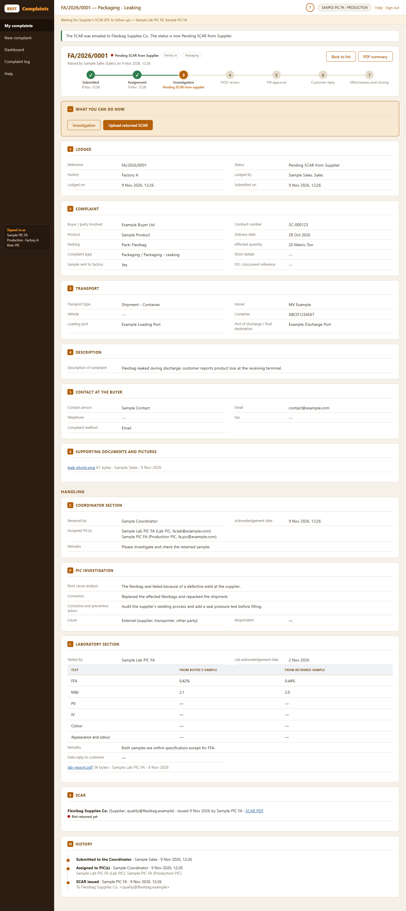 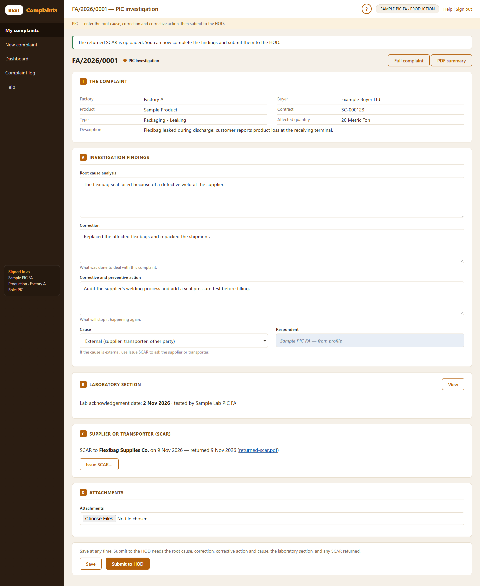

- [ ] Pass

### D. HOD and FM (steps 5 and 6)

**T11 The HOD returns the complaint** (`fa.hod`, then `fa.pic`)
1. Choose **HOD review**. Choose **Return to PIC** with no comment, then with a comment.
2. As `fa.pic`, open the investigation and submit it to the HOD again.

Expected: a comment is required. After the return the status is *PIC investigation*, the PIC is emailed, and the PIC sees the comment at the top of the investigation. `fb.hod` cannot open the complaint at all.

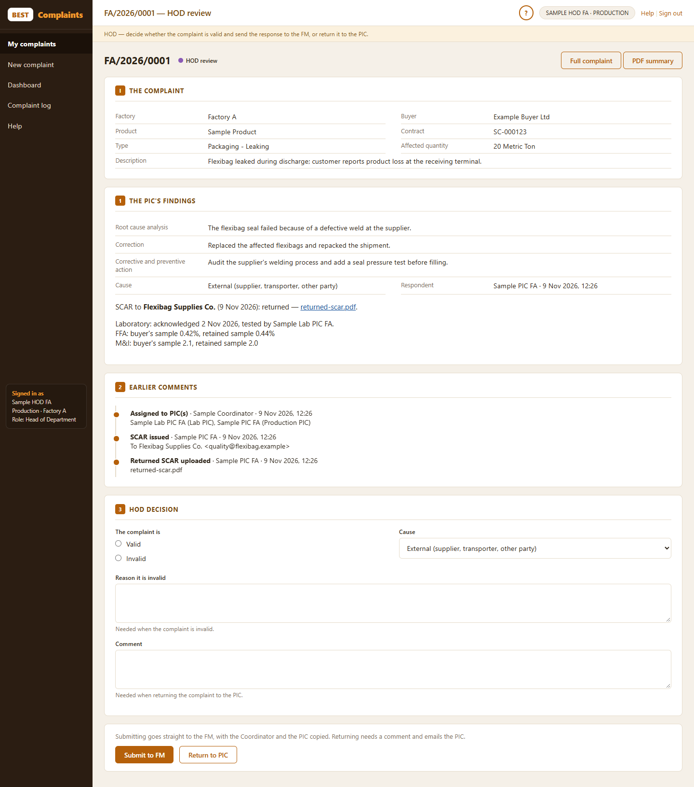 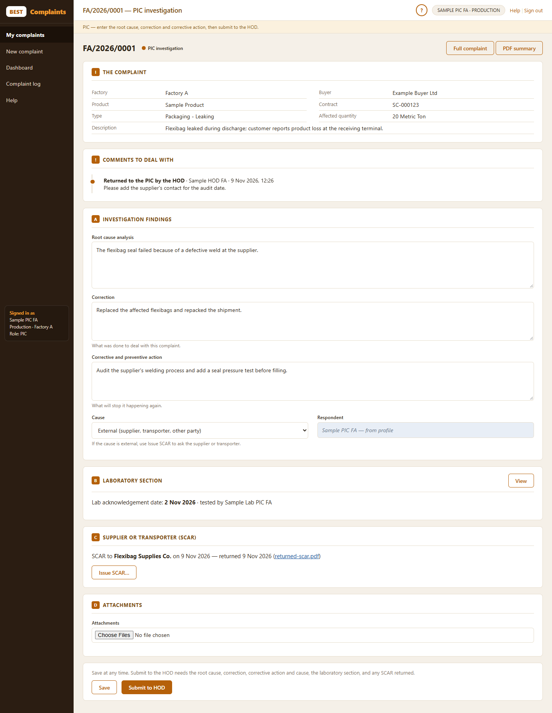

- [ ] Pass

**T12 The HOD decides and submits to the FM** (`fa.hod`)
1. Choose **Invalid** with no reason and **Submit to FM**; then choose **Valid**, a cause, and **Submit to FM**.

Expected: an invalid complaint needs a reason, and the decision and cause are required. The status is *FM approval*, and the FM is emailed with the Coordinator and the PIC copied. It does not go through the Coordinator.

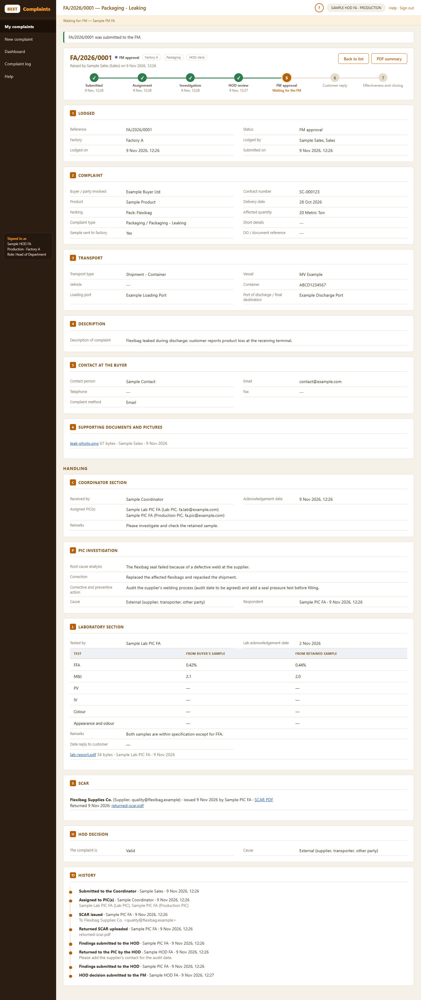

- [ ] Pass

**T13 The FM rejects, then approves** (`fa.fm`, `fa.pic`, `fa.hod`)
1. As `fa.fm` choose **Reject** with no comment, then with a comment.
2. As `fa.pic` amend and submit to the HOD; as `fa.hod` submit to the FM again.
3. As `fa.fm` choose **Approve**.

Expected: a rejection needs a comment and emails the PIC, HOD and Coordinator, and the complaint goes back to *PIC investigation*. The loop can repeat. After the approval the status is *Approved, reply due* and the PIC, HOD and Coordinator are emailed.

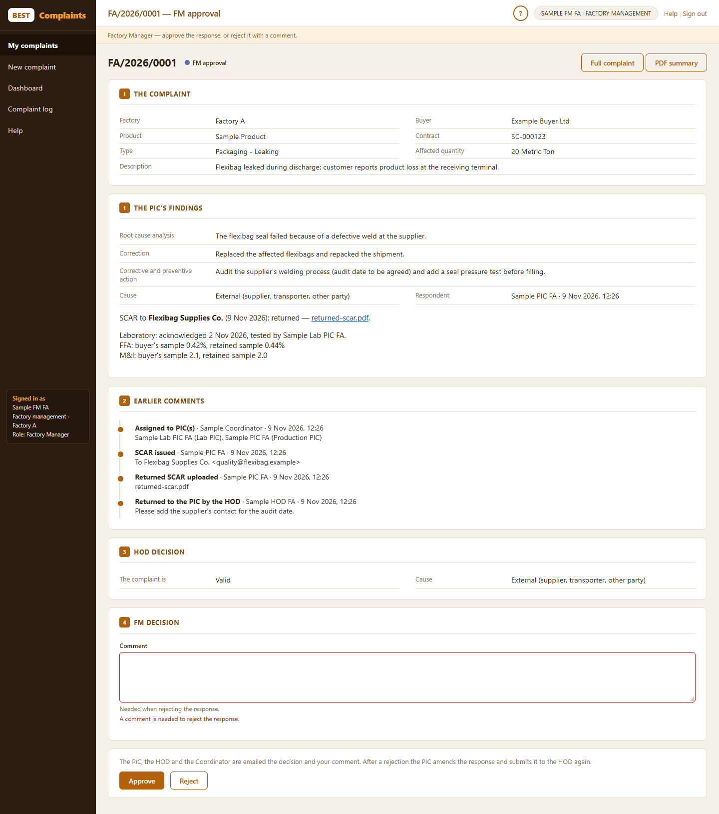 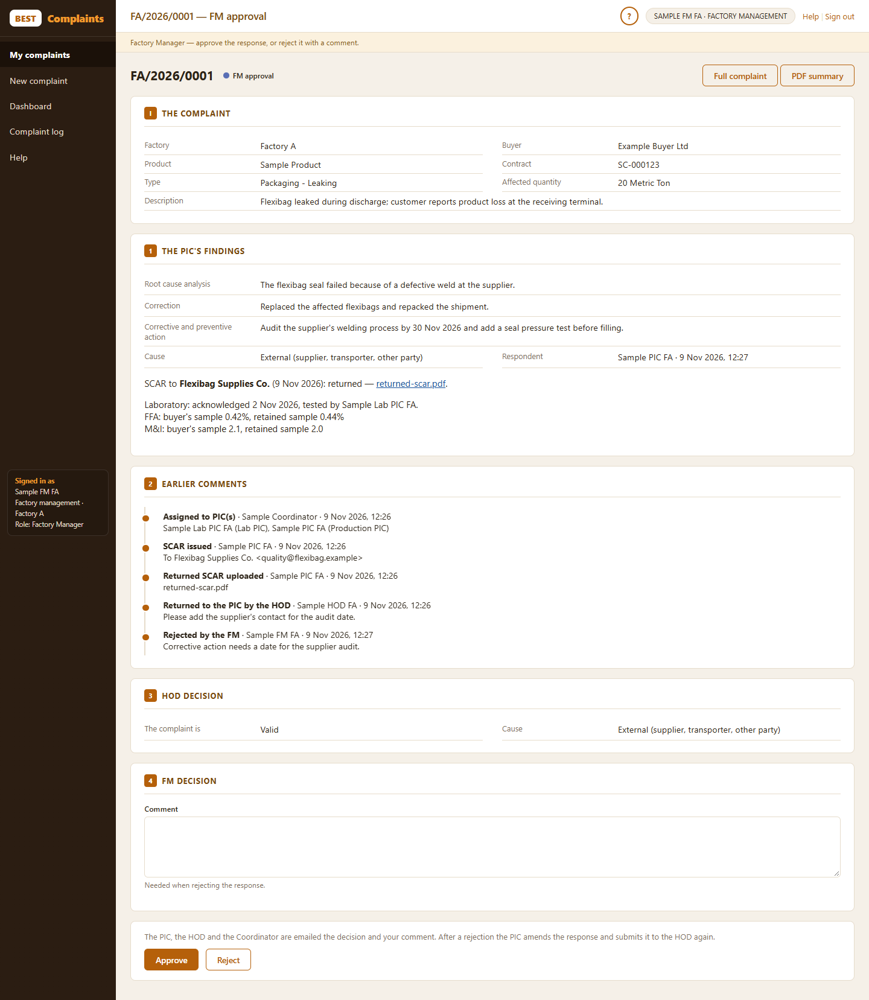

- [ ] Pass

### E. Reply, closing and deleting (steps 7 and 8)

**T14 Reply to the customer** (`fa.pic`)
1. Choose **Reply to customer**. Read the text, edit it, attach a file and choose **Send to customer**.

Expected: the text is built from the findings, the corrective action and the FM's approval. The email goes to the address on the complaint with a copy to the PIC. The status is *Customer Response Sent*, the complaint keeps a copy of the reply, and the HOD, FM and Coordinator are notified. If a SCAR has not been returned, the page says the reply is held and cannot be sent.

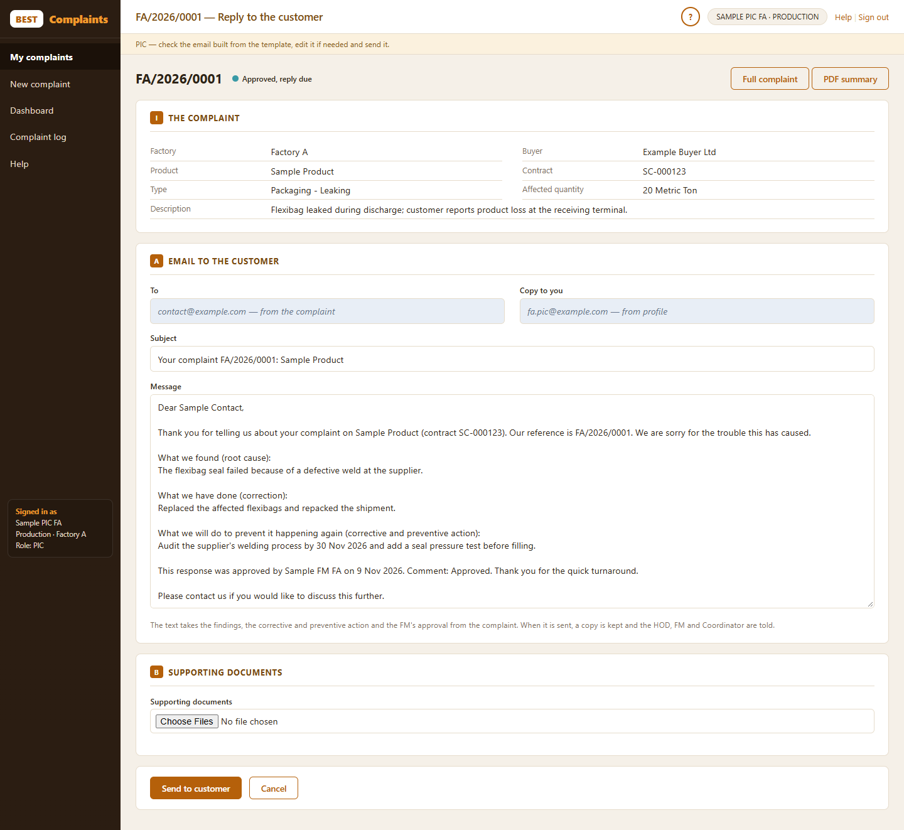

- [ ] Pass

**T15 Effectiveness check and closing** (`mr`)
1. Choose **Effectiveness check and closing** and try **Close the case** with nothing entered.
2. Enter the first verified date and its result (and, if you like, a second), then **Close the case**.
3. Repeat on another complaint, but choose **Not effective: return to PIC**.

Expected: closing needs the first verified date and its result. After closing the status is *Closed* and the dates are on the complaint. *Not effective* needs a comment, goes back to the PIC and emails the PIC.

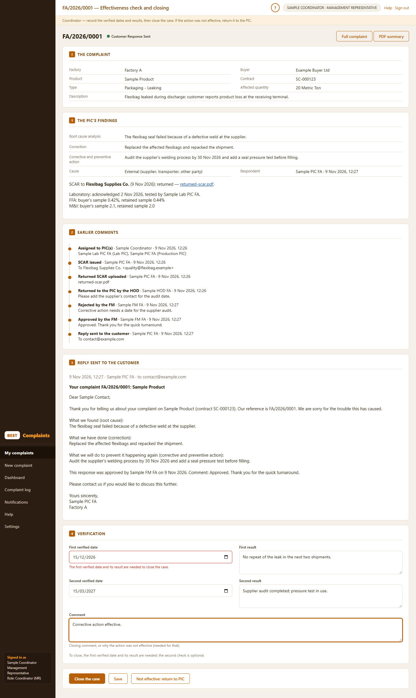 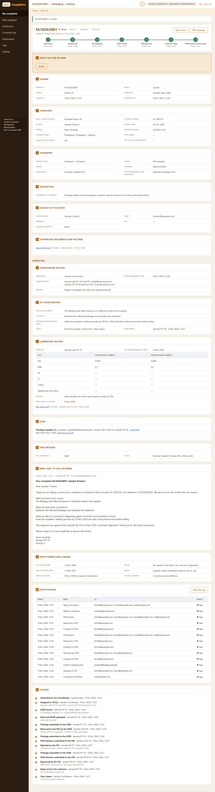

- [ ] Pass

**T16 The progress bar and the history** (anyone who can see the complaint)
1. Open the complaint at each stage.

Expected: the bar at the top shows seven stages (Submitted, Assignment, Investigation, HOD review, FM approval, Customer reply, Effectiveness and closing), with the date of each stage done and *Waiting for …* on the current one. After a return the marker moves back and says why. The *History* card lists every step with who did it and any comment.


- [ ] Pass

**T17 Deleting a complaint** (`mr`, then others)
1. On a submitted complaint choose **Delete**, give no reason, then a reason.

Expected: a reason is required. The complaint is marked *Deleted*, keeps its stage and stays in the list, log and Excel file with its reason. No further action is possible on it. Nobody except the Coordinator is offered *Delete*, and a draft cannot be deleted.

- [ ] Pass

**T18 A HOD or FM who is away** (an administrator, then the deputy)
1. Create an administrator with `.venv\Scripts\python manage.py createsuperuser` (only administrators can edit users; the Coordinator cannot). At `/admin/` open the user `fa.hod` and set a deputy (for example `fb.hod`) and an *away until* date in the future. Put a complaint at *HOD review*.

Expected: the deputy gets the email, can open the Factory A complaint and can do the HOD review. After the *away until* date the deputy no longer sees the factory. The same works for the FM.

- [ ] Pass

### F. Reminders and notifications

**T19 Reminders** (a terminal, then `mr` and the PIC)
1. Make a complaint older: put it at *PIC investigation* and run
   ```powershell
   .venv\Scripts\python manage.py shell -c "from datetime import timedelta; from django.utils import timezone; from complaints.models import Complaint; Complaint.objects.filter(reference='FA/2026/0001').update(status_changed_at=timezone.now()-timedelta(days=4))"
   ```
2. Run `.venv\Scripts\python manage.py send_reminders --dry-run`, then without `--dry-run`, then again.
3. In Settings change the reminder days of the complaint's type to 5 and repeat on a complaint that is 4 days old.

Expected: the dry run lists who would be reminded and sends nothing. The real run emails the person the complaint is waiting for (the Coordinator, PIC, HOD or FM, or the deputy) and a second run sends nothing. Complaints show an **Overdue** tag with the number of days, and the *Overdue* tile on *My complaints* counts them. With 5 days set, a 4-day-old complaint is not reminded. Moving the complaint to the next step starts the count again.

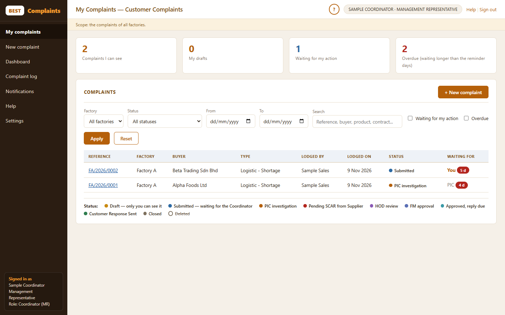 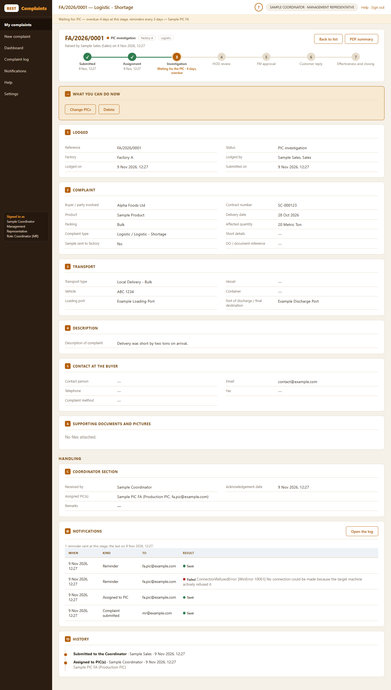

- [ ] Pass

**T20 A reminder that cannot be sent is tried again** (a terminal)
1. With an overdue complaint, run the job with a mail server that is not there:
   ```powershell
   $env:EMAIL_HOST="127.0.0.1"; $env:EMAIL_PORT="1"; .venv\Scripts\python manage.py send_reminders; Remove-Item Env:EMAIL_HOST, Env:EMAIL_PORT
   ```
2. Run `send_reminders` normally.

Expected: the first run reports that the reminders could not be sent; the second sends them. Both appear in the notification log.

- [ ] Pass

**T21 Notifications** (`mr`, `management`, `fa.pic`)
1. Choose **Notifications**. Filter by kind and by *Failed*. Open one email.
2. As `fa.pic` try the same address, and open a complaint page.

Expected: every email is listed with when, kind, complaint, recipients, subject, text, attachments and *Sent* or *Failed* with the reason. A failed email never stopped the step it belonged to. Only the Coordinator and top management have this page and the *Notifications* card on a complaint.

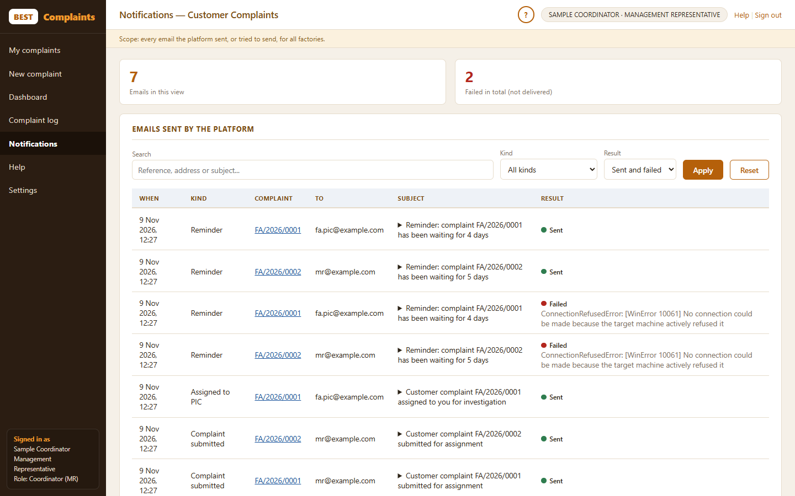 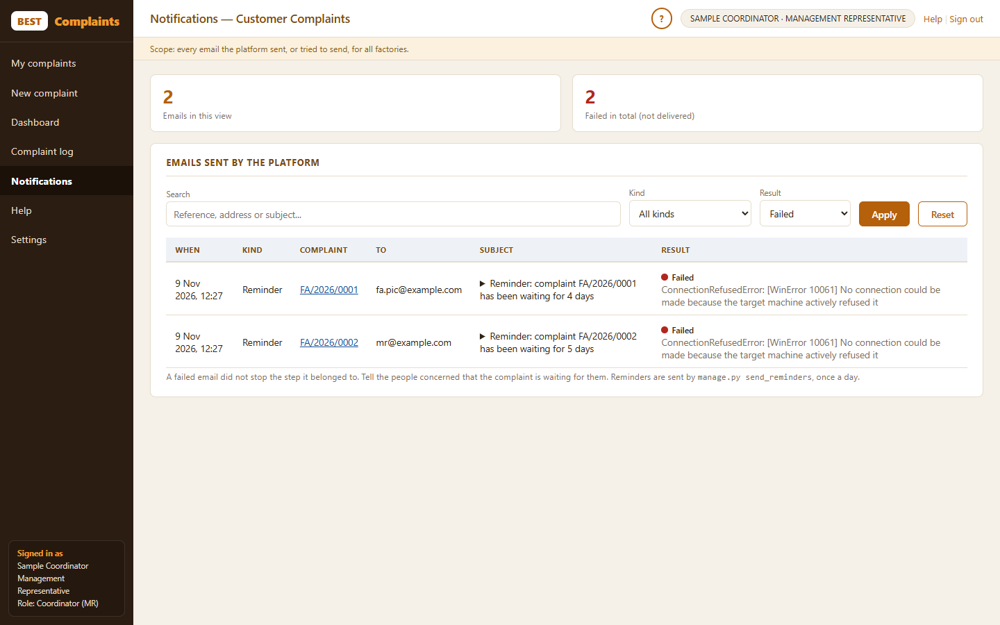 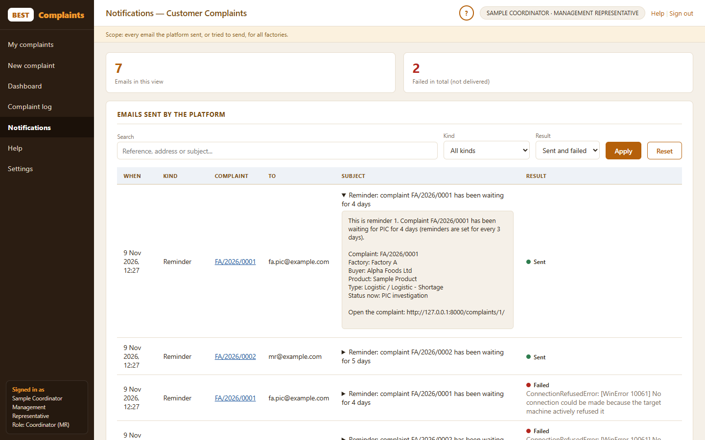

- [ ] Pass

### G. Dashboard and complaint log

For this part, load twelve demo complaints in every state:

```powershell
Get-Content tools\screenshots\demo_data.py | .venv\Scripts\python manage.py shell
```

**T22 Dashboard** (`management`, then `fa.pic`, then `sales`)
1. Choose **Dashboard**. Check the tiles against *Complaint log*.
2. Tick *Factory A* and *Factory B*, set *Lodged from* and *Lodged to*, and choose **Apply**.
3. Sign in as `fa.pic` and as `sales`.

Expected: Total = Valid + Invalid + Under investigation + Deleted. Valid complaints are *in progress* until closed. The charts, the aging bands, the table of where each open complaint is waiting and the reasons for invalid and deleted complaints all follow the same filter. `fa.pic` sees only Factory A and no choice of other factories; `sales` sees only the complaints they lodged. Drafts are never counted.

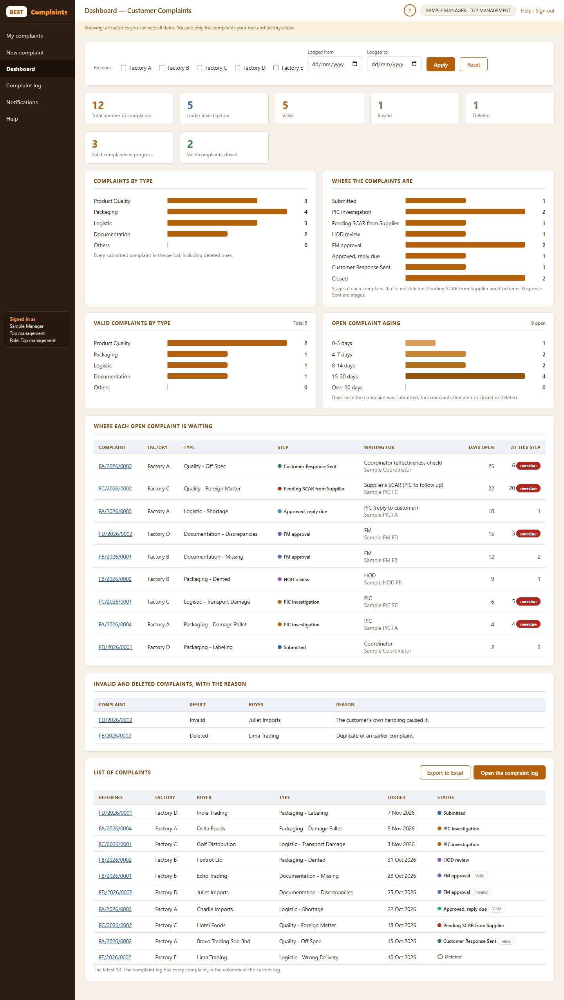 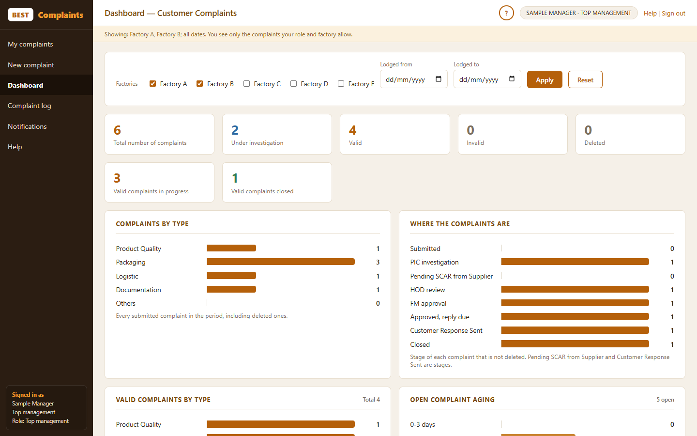 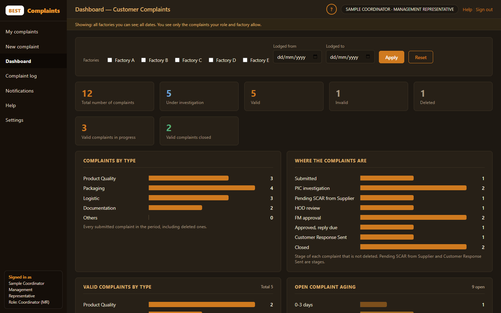

- [ ] Pass

**T23 Complaint log and Excel export** (`management`, `fa.pic`)
1. Choose **Complaint log**. Check the columns and the summary under the table.
2. Choose **Export to Excel** and open the file. Repeat with a factory ticked, and as `fa.pic`.

Expected: the columns are *Customer complaint no., Complaint from, Complaint received by, Issue date, Product, Delivery date, Lab acknowledgement date, Date reply to buyer / trader, IMS acknowledgement date, IMS remarks, Type of problem, Types of valid complaint, Correction, Corrective action, First verified date, Second verified date, Date case closed, Remarks, Deleted, Reason delete*, with a *No.* column first and no CAR number. The Excel file has the same columns and order, real dates, the summary and a line saying who exported it. It follows the factory and date filters and contains only what the user may see.

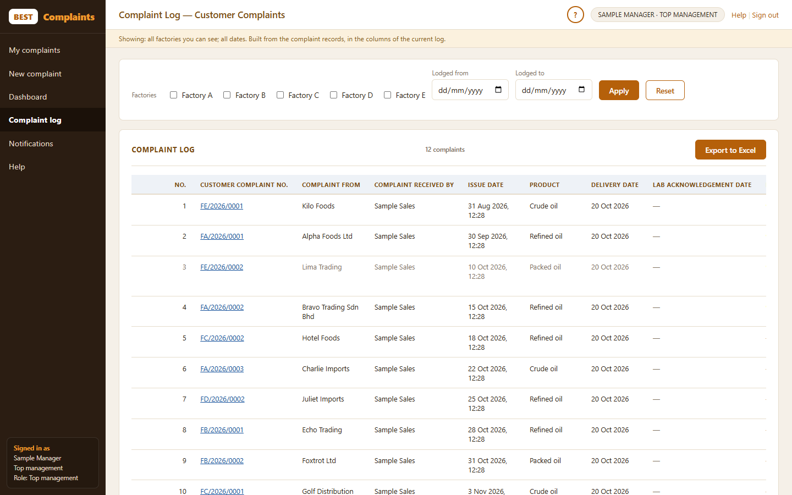 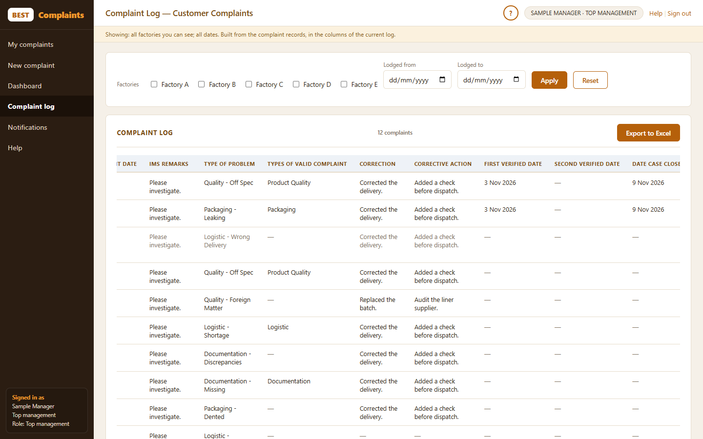

- [ ] Pass

### H. Settings, change log, Help and screens

**T24 Settings and the change log** (`mr`, then an administrator)
1. As `mr` change the reminder days of a complaint type and save. Add a PIC to a factory's list.
2. Create an administrator with `.venv\Scripts\python manage.py createsuperuser`, sign in at `/admin/` and open *Audit log*.

Expected: the change is saved and a new PIC can be chosen in the Coordinator's assignment page. The audit log shows who changed what and when, including complaint steps, and entries cannot be edited or deleted.

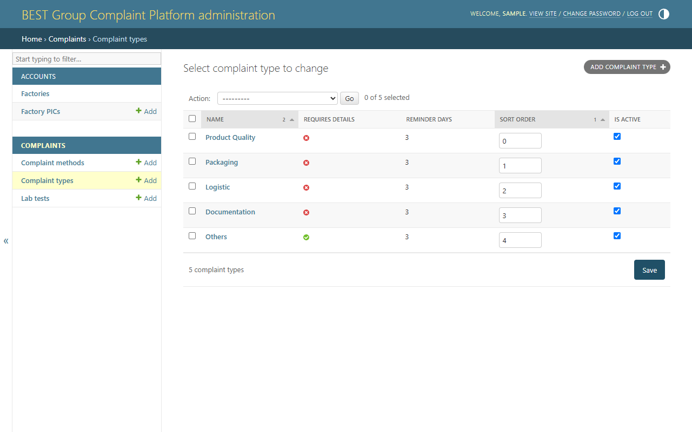 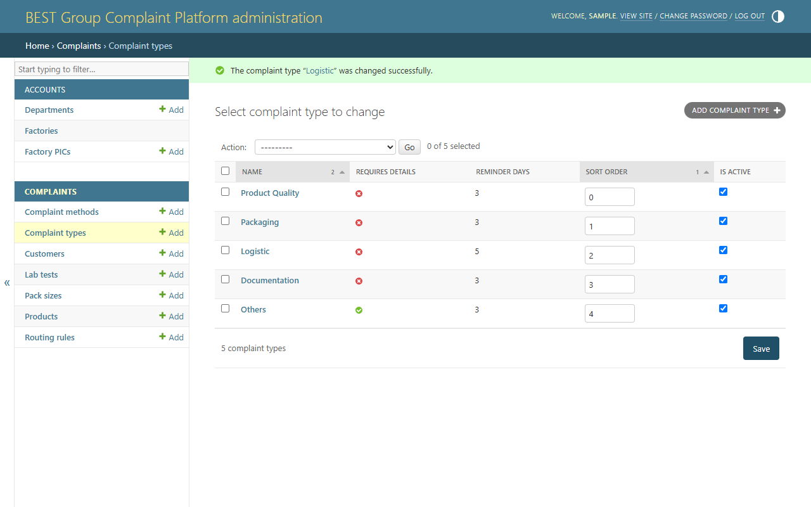 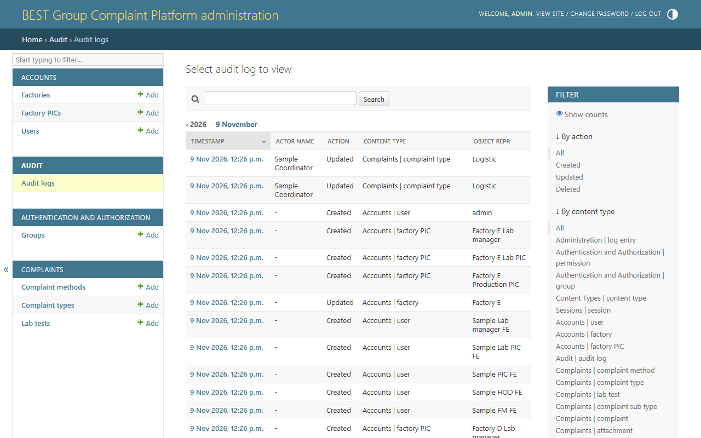 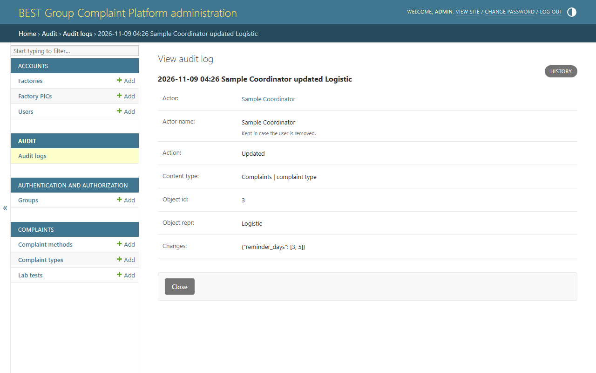

- [ ] Pass

**T25 Help** (any user)
1. Choose **Help**. Search for *SCAR*, then for *Excel*.

Expected: the guide for the user's own role is highlighted, and the list of how-to questions narrows as you type.

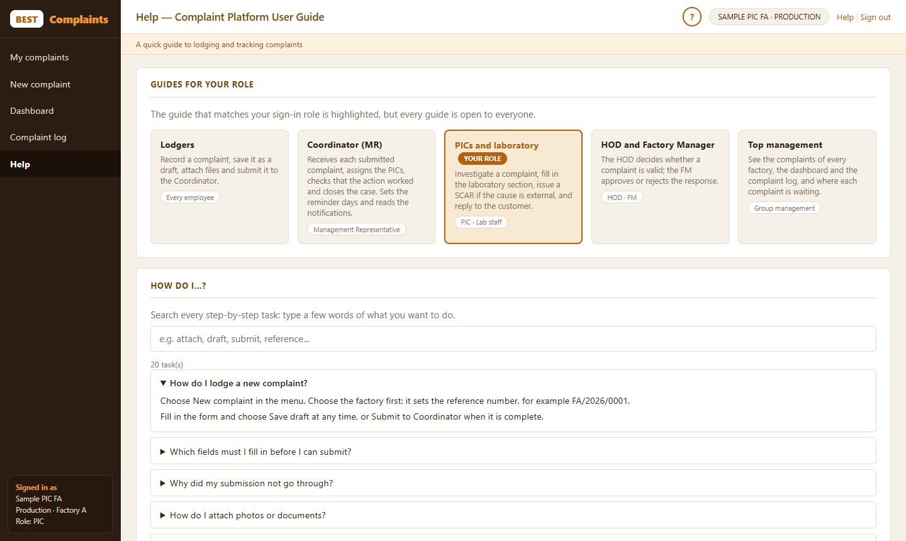

- [ ] Pass

**T26 Phone width and dark mode** (any user)
1. Narrow the browser to about 390 pixels, or use the browser's device mode. Open the list, a form, a complaint, the dashboard and the log. Switch the computer to dark mode.

Expected: the menu becomes a bar across the top, nothing makes the page scroll sideways (wide tables scroll inside their own box), and the colours stay readable in dark mode.

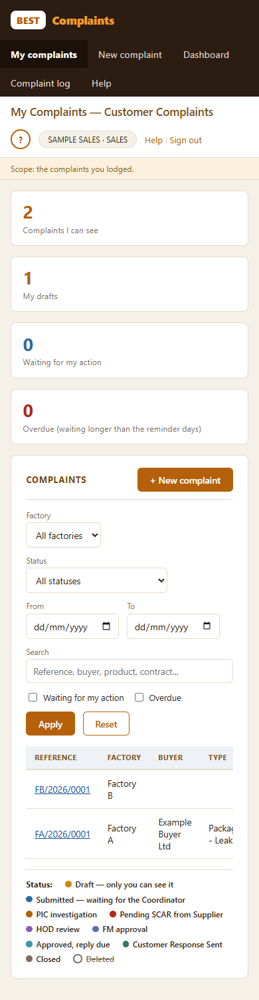 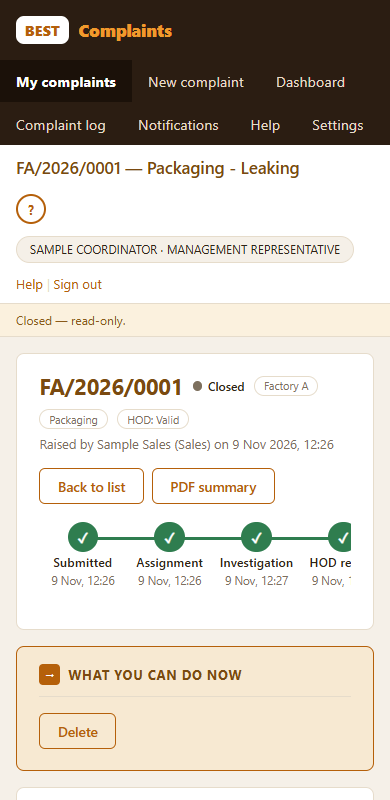 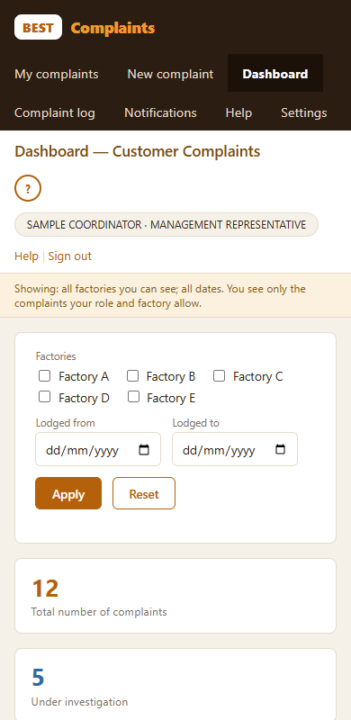

- [ ] Pass

## 5. Which scenario tests which part of the proposal

| Proposal | Scenarios |
|---|---|
| Step 1 and 2: lodge, draft, mandatory fields, reference number | T03, T04, T05, T06 |
| Step 3: assign PICs | T07 |
| Step 4: investigation and laboratory section | T08, T09 |
| Step 4a: SCAR | T10 |
| Step 5: HOD | T11, T12 |
| Step 6: FM and the repeat cycle | T13 |
| Step 7: reply | T14 |
| Step 8: effectiveness and closing | T15 |
| Deleting; deputies | T17, T18 |
| Reminders | T19, T20 |
| Log of changes; notifications | T21, T24 |
| Dashboard and complaint log | T22, T23 |
| Access by role and factory | T02, T06, T11, T22, T23 |
| Progress and history | T16 |

## 6. Useful checks while testing

- **Who is it waiting for?** *My complaints* has a *Waiting for* column and a *Waiting for my action* filter. The line under the page title on a complaint names the people.
- **Did the email go out?** Read the console, or the *Notifications* page as `mr`.
- **A complaint is stuck.** Open it as `mr` and read *History*: it shows the last step and who did it.
- **Sign in as a user who should not be able to do something** and try the address directly. Every step checks the user and the status again, so typing the address must never skip a rule.

## 7. The screenshots

The images in `docs/img/` are made by driving the real application in Chrome, and the same scripts check what each page shows (for example that a laboratory PIC is required, that *Submit to HOD* is locked while a SCAR is pending, and that the Excel file has the right columns). To make them again:

```powershell
pip install playwright openpyxl          # in any Python environment; Google Chrome must be installed
python tools\screenshots\run_all.py
```

It runs five scripts one after the other, prints how many screenshots were saved and how many checks passed for each, and exits with an error if a check fails. It **erases `db.sqlite3` and `media/`** in the project, and puts a clean demo database back at the end. `tools/screenshots/demo_data.py` creates the twelve demo complaints used by the dashboard images.

| Script | Images |
|---|---|
| `lodging.py` | 01 to 05, 15 to 19, 21 to 24 |
| `admin_screens.py` | 06 to 14 |
| `process.py` | 25 to 43 (one complaint through steps 1 to 8) |
| `reminders.py` | 44 to 49 |
| `reports.py` | 50 to 56 |

## 8. Not covered

- Real mail delivery. The platform needs a company mailbox or mail service, set up and tested before the pilot (proposal section 10). Test with the real server settings before going live.
- Large volumes, speed, and backups.
- Browsers other than Chrome, and screen readers, by hand.
- Build step 6 (PDF in the layout of the current report, past complaints) and Phase 2.

## 9. Record of a test round

| Date | Tester | Version or commit | Automated tests | Manual scenarios passed | Notes |
|---|---|---|---|---|---|
| | | | | / 26 | |
